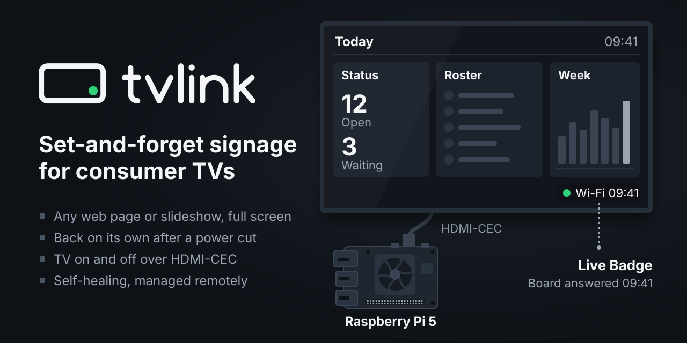
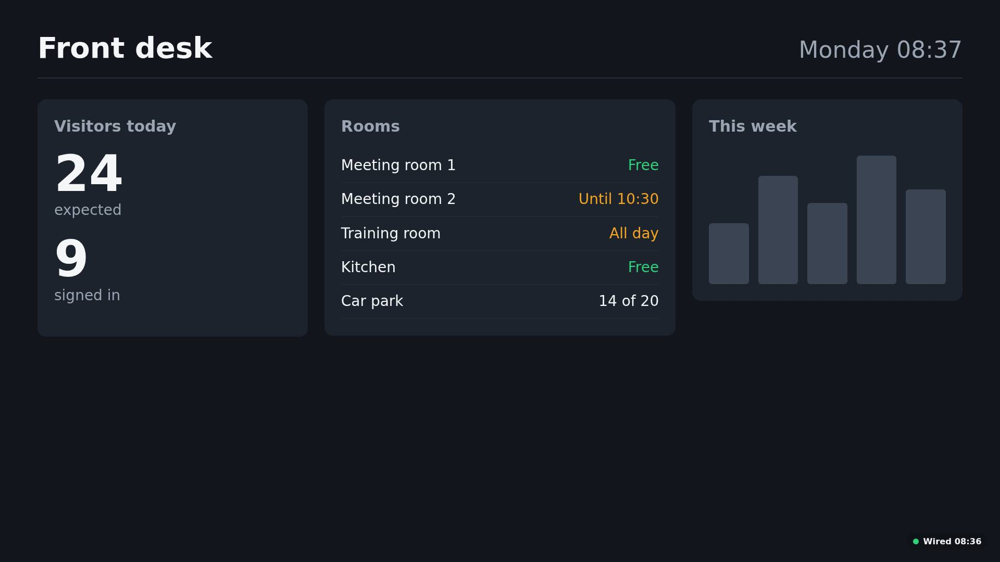
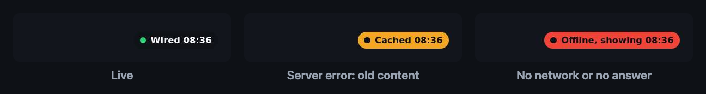
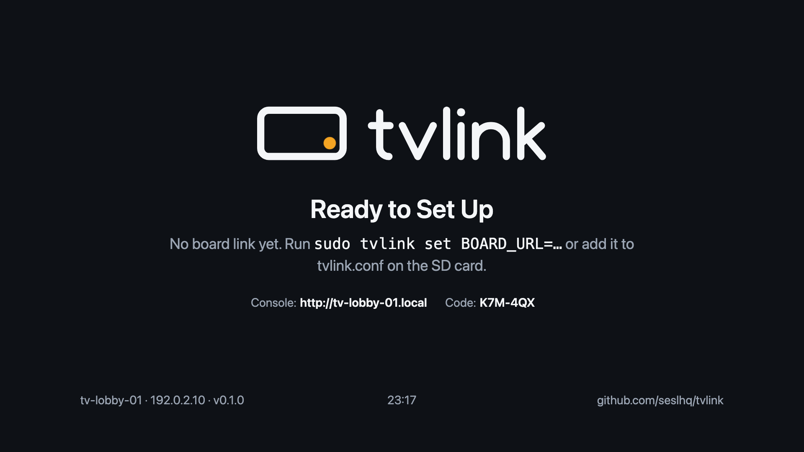
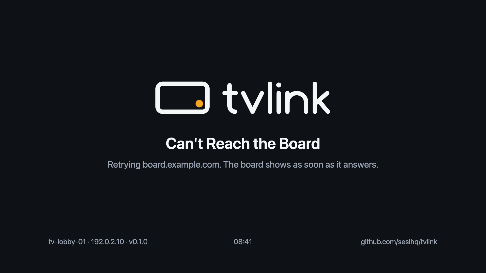
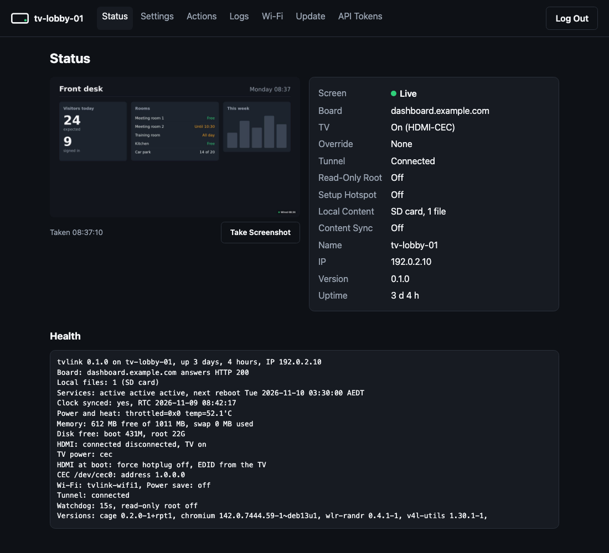
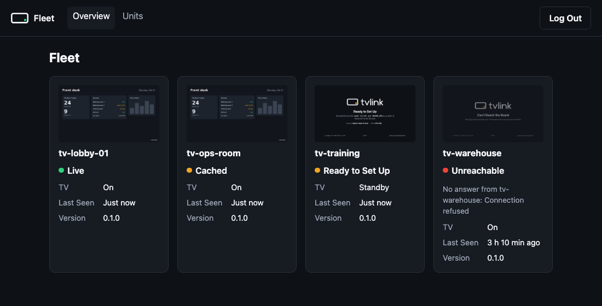

<p align="center">
  
</p>

# tvlink

Set-and-forget digital signage for consumer TVs. A Raspberry Pi 5 shows one web page, dashboard or folder of images
and videos full screen on a TV, turns the TV on and off (HDMI-CEC, infrared or the HDMI signal), and keeps going
through power cuts, network drops and browser crashes without a site visit.



## What it does

- **Any URL, full screen.** Chromium in kiosk mode on a Pi 5. The page refreshes itself, so it works with any
  dashboard; for example SES LHQ TV links, which it was first built for.
- **An honest screen.** A small badge says whether what is on screen is live, or how old it is. A crashed, frozen or
  error page goes back to the splash and returns by itself; the TV never shows a browser error.

  

- **A splash that explains itself.** Until the page answers, the TV says what it is waiting for, with the device's
  name and IP for whoever is fixing it.

  <p>
  </p>

- **Local content.** Images, videos or an `index.html` on the SD card play with no network, as a fallback or on
  their own. Optionally from a USB stick plugged into the Pi, or synced from an https manifest with every file's
  checksum checked and the set swapped in whole.
- **Calm screen changes.** A new page link loads in the background and swaps in once it has loaded, with no splash in
  between; a link that fails keeps the old page. Optionally, a daily browser restart, and the last good screen shown,
  marked Offline, when a unit starts with no network.
- **TV power three ways.** HDMI-CEC; infrared with built-in discrete codes for common brands or codes learned from
  the TV's remote; or the HDMI signal off and on, for TVs that sleep without one. Always on, on-hours, a motion
  sensor, the TV remote, or the remote plus motion wake, with any of them. An override forces it on or off for a
  while (4 h, until 07:00) from the console, and ends by itself.
- **A steady HDMI link.** Optional forced hotplug and a captured EDID, so a TV that is off or on another input at
  boot still gets the right picture.
- **Looks after itself.** Nightly reboot (skipped while the page is down, so the last good screen stays), watchdog,
  and security updates staged so a few units take them first. Where power cuts keep damaging cards, an optional
  read-only root, switched from the console.
- **A console on every unit.** Web pages and a JSON API on the unit itself: the screen, health, settings, actions,
  logs, Wi-Fi, updates and API tokens, from a phone on site or through a tunnel. Claimed with a one-time code from
  the TV ([docs/console.md](docs/console.md)).

  

- **Reachable from anywhere.** One setting, `TUNNEL_TOKEN`, puts the console behind its own Cloudflare Tunnel with
  HTTPS and Cloudflare Access in front: no open ports, no VPN ([docs/cloudflare.md](docs/cloudflare.md)).
- **A fleet console, if you want one.** The same console in fleet mode, on any Linux server: every unit's screen,
  badge, TV state and version on one page, and each unit's pages through its API ([docs/fleet.md](docs/fleet.md)).

  

- **Managed remotely.** One text file on the SD card holds the settings, editable on any PC, in the console, or with
  `tvlink set` over Raspberry Pi Connect or SSH, which stay as a way in when the console can't be reached.

## How it works

```
TV  <── HDMI + CEC ──  Raspberry Pi 5, Raspberry Pi OS Lite
    <───── IR ───────  optional: an IR LED on a GPIO pin
                         tvlink.service          cage + Chromium on tty1: splash until the page answers, then the
                                                 page; tvlink-agent drives Chromium over a DevTools pipe (badge,
                                                 recovery)
                         tvlink-power.service    TV power over CEC, IR or the HDMI signal: schedule, motion sensor,
                                                 power-cut wake
                         tvlink-net.service      Wi-Fi networks from the settings file
                         tvlink-console.service  the console on port 80: web pages and JSON API
                         tvlink-tunnel.service   optional: cloudflared, a Cloudflare Tunnel to the console
                         tvlink-content.service  optional: synced content from an https manifest
                         tvlink-usb@.service     optional: a USB stick with a tvlink folder, mounted read-only
                         tvlink-reboot.timer     nightly reboot, gated on the page answering
                         /boot/firmware          tvlink.conf and the local content folder (FAT: any PC can edit it)
```

Bash, Python 3 and systemd; no build step, no containers, no dependencies beyond Raspberry Pi OS packages. The only
thing listening on the network is the console. The design and the reasons behind it: [docs/design.md](docs/design.md).

## Quick start

You need a Raspberry Pi 5 (1 GB is enough) with the official 27 W power supply and Active Cooler, a high-endurance
microSD card, a micro-HDMI cable, and a TV with HDMI-CEC turned on (or an IR LED: [setup](docs/setup.md)).

1. Write Raspberry Pi OS Lite (64-bit, Trixie) with Raspberry Pi Imager; set the hostname, a user, SSH with a key,
   and Wi-Fi if there is no Ethernet.
2. Copy tvlink to the Pi and install it:

   ```bash
   git clone https://github.com/seslhq/tvlink
   scp -r tvlink <user>@tv-lobby-01.local:
   ssh -t <user>@tv-lobby-01.local sudo ./tvlink/install.sh
   ```

3. Claim its console at `http://tv-lobby-01.local` with the code on the TV, point it at a page in Settings (or
   `sudo tvlink set BOARD_URL=https://dashboard.example.com/board`), then reboot.

The full guide, including TV settings and the CEC test: [docs/setup.md](docs/setup.md).

## Try it without a Pi

On an Apple silicon Mac, `tests/vm.sh` installs tvlink in a Linux VM with stand-ins for the TV (CEC and IR), Wi-Fi,
the motion sensor and a USB stick, and runs 254 checks against the real services: [docs/testing.md](docs/testing.md).

## Documentation

| Guide | Covers |
| --- | --- |
| [Setup](docs/setup.md) | Hardware, provisioning a unit, TV settings, the CEC test, EDID, wiring a motion sensor and IR |
| [Configuration](docs/configuration.md) | Every setting, power modes and methods, local, USB and synced content, the screen |
| [Console](docs/console.md) | The unit's web pages and JSON API, claiming, security |
| [Cloudflare](docs/cloudflare.md) | A tunnel per unit, Access in front, a service token for the fleet console |
| [Fleet](docs/fleet.md) | The fleet console: installing it on a server, adding units, security |
| [Operations](docs/operations.md) | Remote management, updates, troubleshooting, on-site notes, replacing a unit |
| [Design](docs/design.md) | How the parts fit, the decisions behind them, platform facts |
| [Testing](docs/testing.md) | Checks, the VM harness, the checklist for real hardware |
| [Brand](docs/brand.md) | Logo, colours and the trademark policy |

## Status

Tested in CI and in the Linux VM. Not yet proven on a Pi with real TVs: the hardware checklist in
[docs/testing.md](docs/testing.md) is the next step, and reports from your own hardware are welcome.

## Contributing and licence

Pull requests and hardware reports welcome: [CONTRIBUTING.md](CONTRIBUTING.md). Security reports:
[SECURITY.md](SECURITY.md).

[Apache-2.0](LICENSE). Copies and forks keep [NOTICE](NOTICE) and the file headers, which point back to this repo.
The licence grants no rights to the tvlink name or logo: a fork that is passed on is renamed and drops the logo
([docs/brand.md](docs/brand.md)).
