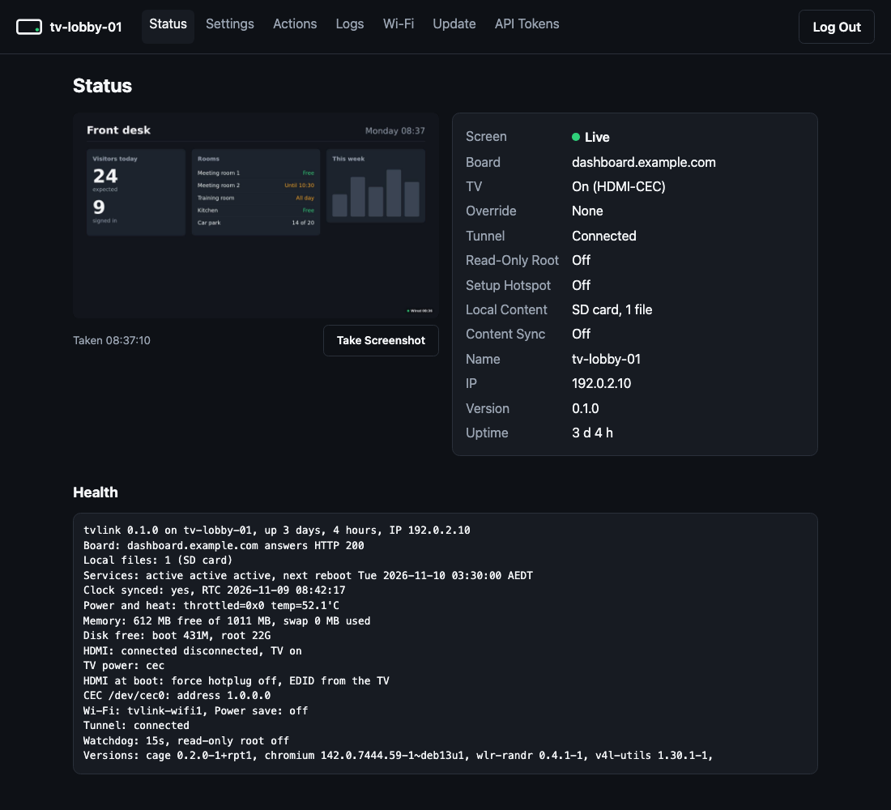
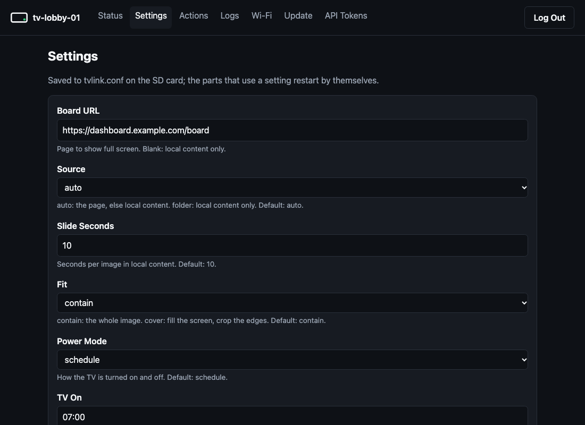

# Console

Every unit hosts its own console: web pages and a JSON API on port 80, for the unit's status, settings, actions,
logs, Wi-Fi, updates and API tokens. It works from a phone on the same network as the unit, or from anywhere through a
tunnel in front of it ([Cloudflare](cloudflare.md)). No other server is needed; a [fleet console](fleet.md) can show
many units in one place.



## Claiming a unit

The console is on from the first install, but until it has a password it shows only a claim page. Claiming needs a
one-time code, so someone on the network who can't see the TV can't take the unit over.

1. Find the code. The splash shows it with the console's address, eg `Console: http://tv-lobby-01.local Code: K7M-4QX`.
   A unit already showing its page puts it on screen with `sudo tvlink identify`; on the unit, `sudo tvlink console
   claim` prints it.
2. Open the address (or `http://<IP>` where `.local` names don't resolve), enter the code and choose a password of at
   least 10 characters. The code then stops working and leaves the splash.

Forgotten the password: `sudo tvlink console reset` on the unit (eg over Raspberry Pi Connect) goes back to claim mode
and prints a new code. API tokens keep working.

## Pages

| Page | Shows or does |
| --- | --- |
| Status | The last screenshot (Take Screenshot for a new one), the screen state as the badge sees it, the TV's power and the power method, an override in force, the tunnel, the read-only root (and what the next boot changes) (off, connected or not connected), where local content plays from (USB stick, synced or SD card) and the last content sync, name, IP, version, uptime, and `tvlink doctor`'s health lines |
| Settings | Every setting `tvlink set` takes, as a form built from `tvlink keys --json`; values are checked by `tvlink set` and errors show beside the field; a change to the boot files says to reboot |
| Actions | Reload Page, Identify, Take Screenshot, TV On and TV Off (by the power method, which the page names), Reboot (asks first, on the page), and Override: Force On or Force Off for a length (or until the next TV On or TV Off) or until a time, and Clear Override ([overrides](configuration.md#overrides)); the read-only root's Turn On or Turn Off (asks first, on the page; takes a reboot) ([operations](operations.md#read-only-root-optional)) |
| Logs | The last 200 lines of the kiosk, TV power and Wi-Fi network logs |
| Wi-Fi | The `WIFI*` settings and the networks the unit can see |
| Update | `tvlink update` with an archive URL and its SHA-256 ([operations](operations.md#updates)) |
| API Tokens | Create, list and revoke tokens for the API |



Secrets (`WIFI1_PSK`, `WIFI2_PSK`, `TUNNEL_TOKEN`) are write-only: the page shows `(set)` or `(not set)`; a blank field
keeps the current one, and Clear removes it.

## Security

- **Privileges.** The console runs as its own system user, `tvlink-console`, in a systemd sandbox (read-only system,
  private `/tmp`, no home directories), with only the capability to bind port 80. It reaches root through sudo, for a
  fixed list of `tvlink` commands in `/etc/sudoers.d/tvlink-console` (`status`, `doctor`, `on`, `off`, `identify`,
  `reload`, `screenshot`, `reboot`, `logs`, `set`, `update`, `override`, `overlay`). Arguments go to sudo as a list, never through a shell,
  and sudo does not log them (`set` can carry a Wi-Fi password).
- **Login.** One password per unit, stored as a PBKDF2-SHA256 hash (600,000 rounds) readable only by the console user.
  Sessions are in memory (a restart logs everyone out) and expire after 12 hours. The cookie is `HttpOnly` and
  `SameSite=Strict`, and `Secure` when the request came through an HTTPS tunnel or proxy (`Cf-Visitor` says
  `https`, or `X-Forwarded-Proto: https`).
- **Forms.** Every change needs the session's CSRF token. Five wrong passwords or claim codes from one address in five
  minutes (or 20 from all) lock logins out until the window passes. Through cloudflared on the unit, the address is
  the visitor's (`Cf-Connecting-IP`), taken only from loopback, so no one on the network can choose their own.
- **Tokens.** Random 256-bit, shown once when made, stored as SHA-256 only. A token can do everything the console can,
  including updates, so give each fleet or script its own and revoke it when done.
- **Plain HTTP.** On the local network, traffic (including the password) is not encrypted. For access from elsewhere
  put a tunnel with HTTPS in front of it: `TUNNEL_TOKEN` and Cloudflare Access ([Cloudflare](cloudflare.md)). No
  header authenticates anyone, including those Access adds: every request needs a session or an API token.

## API

JSON over HTTP under `/api/`. Authenticate with a token (`Authorization: Bearer TOKEN`), or with a logged-in session
plus the `X-CSRF-Token` header on changes (every page sends the token in that response header). Without either:
`401`. Errors are `{"error": "..."}`.

| Method and path | Body | Answer |
| --- | --- | --- |
| `GET /api/status` | | `name`, `ip`, `version`, `state` and `screen` (badge state), `code`, `host`, `tv`, `tunnel` (`off`, `connected`, `not connected`), `content` (eg `USB stick, 3 files`, or `None`), `sync` (`off`, or the last sync, eg `OK 14:05: 4 files, 12 MB, unchanged`), `override` (eg `on until Tue 10 Nov 07:00`, or `none`), `overlay` (the read-only root: `on`, `off`, or eg `off, on after a reboot`), `uptime` (s), `health` (lines), `screenshot` (time taken, or null). `?brief=1`: `health` empty, in a fraction of the time |
| `GET /api/settings` | | `version` and `keys`: `key`, `type` (`text`, `url`, `time`, `number`, `choice` with `choices`, `secret` with `set`), `label`, `hint`, `value`, `default` |
| `POST /api/settings` | `{"KEY": "value", ...}` | `{"ok": true}`, or `400` with `error` and the `key` it is about |
| `POST /api/action` | `{"action": "reload"}`: `reload`, `identify`, `screenshot`, `on`, `off` or `reboot` | `ok` and the command's `message` |
| `POST /api/override` | `{"override": "on", "for": "4h"}`; `"until": "07:00"` instead of `for`; neither: until the next TV On or TV Off; `{"override": "clear"}` | `ok` and `message`, or `400` with `error` |
| `POST /api/overlay` | `{"overlay": "on"}` or `off`: the read-only root from the next boot | `ok` and `message`, or `400` with `error` |
| `GET /api/screenshot` | | The last screenshot (JPEG), or `404` |
| `POST /api/screenshot` | | Takes one, then answers as GET |
| `GET /api/logs?part=kiosk` | | `{"kiosk": "..."}`; without `part`: kiosk, power and net |
| `GET /api/wifi` | | `networks`: `ssid`, `signal` (%), `security` |
| `POST /api/update` | `{"url": "https://...", "sha256": "..."}` | `ok` and `message` |
| `GET /api/tokens` | | `tokens`: `name`, `created` |
| `POST /api/tokens` | `{"name": "fleet"}` | `name` and `token`, shown only this once |
| `DELETE /api/tokens/NAME` | | `{"ok": true}`, or `404` |

```bash
curl -H "Authorization: Bearer $TOKEN" http://tv-lobby-01.local/api/status
curl -H "Authorization: Bearer $TOKEN" -d '{"OVERLAY_CORNER": "top-left"}' http://tv-lobby-01.local/api/settings
curl -H "Authorization: Bearer $TOKEN" -d '{"action": "reload"}' http://tv-lobby-01.local/api/action
```
