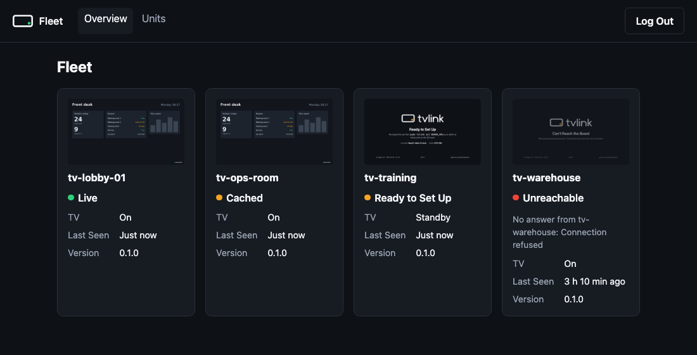

# Fleet console

Every unit runs its own console, and that is all a unit needs. For many units, the fleet console puts them in one
place: the same console code in fleet mode (`tvlink-console --fleet`), on any Linux box with Python 3.9 or later, no
Pi needed. It holds a list of units and reaches each through its console's API, with the unit's API token and, behind
Cloudflare Access, a service token.



## Pages

| Page | Shows or does |
| --- | --- |
| Overview | Every unit: its last screenshot, its badge as on its TV (Live, Cached, Offline, or what the splash shows), TV state, when the fleet console last heard from it, and its version; Unreachable, with what it said last, when it does not answer |
| Units | The units and their addresses; New Unit adds one, Remove forgets one |
| A unit's pages | Click a unit: its Status, Settings, Actions, Logs, Wi-Fi and Update pages, the same pages as on the unit, served by the fleet console through the unit's API |

The overview asks every unit at once and waits at most 4 s: a unit that is down shows as Unreachable without slowing
the page, and a slow answer shows on the next look. API tokens of a unit are managed on the unit itself.

## Install

On Debian or Ubuntu (any systemd Linux with Python 3):

```bash
git clone https://github.com/seslhq/tvlink && cd tvlink
sudo install -m 755 tvlink-console /usr/local/bin/
sudo install -m 644 tvlink-fleet.service /etc/systemd/system/
sudo systemctl daemon-reload && sudo systemctl enable --now tvlink-fleet
sudo cat /run/tvlink-fleet/claim # the claim code
```

`tvlink-fleet.service` runs it as a throwaway system user (systemd's `DynamicUser`) in a sandbox, listening on
`127.0.0.1:8080` only: put a tunnel with HTTPS and Access in front of it
([Cloudflare](cloudflare.md#the-fleet-console-behind-its-own-tunnel)).
Before the tunnel is up, reach it over SSH: `ssh -L 8080:localhost:8080 <server>`, then `http://localhost:8080`.
To listen elsewhere, add a drop-in (`sudo systemctl edit tvlink-fleet`) with eg
`Environment=TVLINK_CONSOLE_PORT=8090` or `Environment=TVLINK_CONSOLE_ADDR=::` (all addresses: only on a trusted
network, as it is plain HTTP).

Update: copy the new `tvlink-console` over the old one and `sudo systemctl restart tvlink-fleet`.

## Claim it and add units

1. Open it, enter the claim code and choose its password (at least 10 characters). Forgotten later:
   `sudo rm /var/lib/tvlink-fleet/password`, `sudo systemctl restart tvlink-fleet`, and claim it again.
2. On each unit's console, API Tokens: create a token named eg `fleet` and copy it.
3. In the fleet console, Units, New Unit: a name (eg `tv-lobby-01`), the unit's address (its tunnel's hostname, eg
   `https://tv-lobby-01.example.com`, or `http://tv-lobby-01.local` on the same network), the API token, and, behind
   Access, the service token's client ID and secret ([Cloudflare](cloudflare.md#a-service-token-for-the-fleet-console)).
   To change one, remove it and add it again.

Each unit's error says what to check: no answer, a login page from Access (the service token), or a refused API
token.

## Security

- The fleet console holds every unit's API token, which can do anything on its unit: treat the server and its
  `/var/lib/tvlink-fleet` (only the service's user and root can read it) as you would those units. Put Access in front
  of it for the people who manage the fleet only; its own password is the second check.
- Tokens and secrets are never shown again once entered, and never leave the fleet console except to their unit. It
  never follows a redirect, so a unit's tokens can't be sent on elsewhere.
- Login, sessions, CSRF tokens and the login limit work as in the [unit console](console.md#security). Plain HTTP
  units (`http://`) send their API token unencrypted: use them on a trusted network only.

## Example deployment

SES LHQ runs its fleet console at `tvlink.seslhq.com`, behind its own Cloudflare Tunnel and Access, with each unit
at its own first-level hostname such as `tv-lobby-01.seslhq.com`, reached with a service token and the unit's API
token. Nothing in tvlink depends on it: any domain on Cloudflare works the same way.

## Limits

- What the fleet console last heard from each unit, and the screenshots, are kept in memory: after a restart, a unit
  that is down shows no last seen until it answers again.
- Thumbnails are the units' full screenshots, fetched once per new screenshot.
- No alerts: the overview shows the state when you look.
